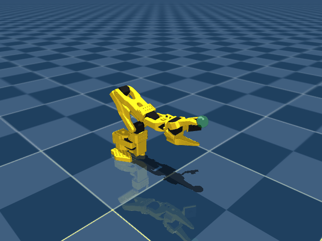

# SO-101 Physical AI simulation

A MuJoCo simulation of the SO-101, a first reinforcement learning task, and keyboard control of all six joints. The robot uses the pinned [MuJoCo Menagerie SO101 model](https://github.com/google-deepmind/mujoco_menagerie/tree/3abca2e302625cec9429c49806121ea2855cef81/robotstudio_so101), with its original dynamics, meshes, collisions, joint limits, actuator limits, and [Apache-2.0 license](assets/robotstudio_so101/LICENSE).



The included policy achieved **80 successes in 100 independent evaluation episodes**, with **9.29 mm mean final distance** across all episodes. No-motion and random baselines both achieved 0/100. The selected run completed 301,056 training steps; validation selected the checkpoint at 200,000 steps. Full metrics, every episode, learning curves, and both success and timeout examples are in the [recorded experiment](reports/first_reach/README.md).

## Run locally

Run these commands from the repository root in PowerShell. The implementation was verified with Python 3.14.6 and the exact versions in `requirements.txt`. If the dependencies are already installed, use that Python directly. For a new installation:

```powershell
python -m venv .venv
.\.venv\Scripts\python -m pip install -r requirements.txt
.\.venv\Scripts\Activate.ps1
```

The robot assets are included. Verify their hashes with:

```powershell
python scripts/fetch_model.py --verify
```

If assets are missing or damaged, `python scripts/fetch_model.py` restores them from the pinned upstream commit. It does not download from a moving branch. `assets/model_manifest.json` records the source commit and every downloaded file's SHA256; Git preserves the upstream asset bytes.

## Keyboard control

```powershell
python -m so101_sim.teleop
```

Click the MuJoCo 3D view so it receives keyboard input. Use plain keys without Ctrl or Alt. Each press changes a joint target by 2 degrees. Repeated presses continue moving that target; behavior while holding a key follows the viewer's key-repeat behavior. Position commands are limited to 0.8 rad/s and clamped to the intersection of joint and actuator limits.

| Increase / decrease | Joint |
| --- | --- |
| Q / A | Shoulder pan |
| W / S | Shoulder lift |
| E / D | Elbow flex |
| R / F | Wrist flex |
| T / G | Wrist roll |
| Y / H | Gripper opening angle |
| Backspace | Move joint targets smoothly back to home |
| N | Reset the robot and sample a new reach target |
| Space | Pause / resume physics |
| Escape | Exit |

Commands entered while paused take effect after resuming. MuJoCo also receives the keys, so some letters toggle its rendering options; Tab shows or hides its UI. Camera and rendering controls remain available. This keyboard mode owns the physics state, so viewer sliders and mouse perturbations do not change it. An optional `--seconds 10` closes the viewer automatically.

Keyboard control operates the **simulated** arm. It does not connect to physical servos or a serial port. The six-joint model remains enabled, so manual commands can still cause contacts; command limits do not provide collision-free path planning.

## First learning task: local reach and hold

The policy moves the end-effector site `gripperframe` to a green target. An episode succeeds when the Cartesian distance is below **15 mm** and the first three joint velocities have a combined magnitude below **0.3 rad/s**, continuously for **10 control steps (0.5 s)**. The deadline is 120 control steps (6 s).

- The first three joints are learned actions: shoulder pan, shoulder lift, and elbow flex. Wrist flex, wrist roll, and gripper targets stay at their home values. Keyboard mode can control all six.
- Physics runs at 200 Hz and the policy at 20 Hz. Actions request absolute joint targets within a conservative local joint box, with the same 0.8 rad/s command slew limit.
- Each reset adds small joint-position jitter. A new target is sampled by forward kinematics inside a local joint box, at least 40 mm from the starting end-effector and above 80 mm height, rejecting contact penetrations deeper than 4 mm.
- The 15-value observation contains joint positions, velocities, current actuator commands, Cartesian target, and Cartesian error. The joint configuration used to sample the goal is never given to the policy. There is no IK controller or scripted task solution.
- The reward penalizes Cartesian distance and velocity, adds a nonpositive proximity term, and gives a terminal success bonus. Per-step reward cannot become positive merely by waiting near a target. Penetrating contacts beyond 4 mm, checked at each 20 Hz control boundary, terminate with a penalty.

Exact joint boxes, reward coefficients, reset settings, and observation scaling are recorded by `SO101ReachEnv.task_config` and checkpoint metadata. This is a state-based first exercise in a restricted local workspace. It does not yet teach grasping, vision, arbitrary wrist orientation, or operation on real hardware. Successful simulation episodes do not establish sim-to-real performance.

## Train and evaluate

Start a new run explicitly:

```powershell
python -m so101_sim.train --timesteps 300000 --output runs/my_reach --seed 42 --log-std-init -2
```

The trainer uses PPO on CPU with eight environments and initial action standard deviation exp(-2), approximately 0.135. It records training curves, validation curves, full configuration, asset and environment signatures, and checkpoints. Requested timesteps round up to complete PPO rollouts. Existing run directories containing checkpoints are protected from accidental overwrite. No training starts when importing modules or running keyboard control.

Checkpoint selection uses 20 fixed validation seeds starting at 10000. Final evaluation uses 100 separate seeds starting at 20000, comparing deterministic learned actions with no-motion and uniformly random action baselines under identical initial conditions. The report contains every episode and a 95% Wilson interval for success rate.

Evaluate the included first policy or play five episodes:

```powershell
python -m so101_sim.evaluate --checkpoint checkpoints/first_reach/best_model.zip --episodes 100 --output runs/recheck.json
python -m so101_sim.evaluate --checkpoint checkpoints/first_reach/best_model.zip --episodes 5 --render --output runs/playback.json
```

Keep each checkpoint's `.metadata.json` sidecar. Loading checks the checkpoint hash, pinned model assets, task configuration, environment source, and library versions. An incompatible environment is rejected explicitly; checkpoints are not migrated automatically.

## Verification

```powershell
python -m unittest discover -s tests -v
python scripts/fetch_model.py --verify
```

The tests cover the Gymnasium contract, seeded physics, reachable-target constraints, success hold duration, time limits, action validation, command limits, reward behavior, keyboard mappings, pause/reset behavior, and real MuJoCo movement under a simulated viewer callback. Offscreen rendering was also checked. Interactive keyboard behavior in a visible window remains a manual check.

## Project layout

| Path | Purpose |
| --- | --- |
| `so101_sim/env.py` | Shared model and reach-and-hold environment |
| `so101_sim/teleop.py` | Keyboard simulation control |
| `so101_sim/train.py` | Explicit PPO training entry point |
| `so101_sim/evaluate.py` | Checked policy loading, evaluation, and playback |
| `assets/robotstudio_so101/` | Unmodified, licensed upstream robot model |
| `checkpoints/first_reach/` | Included trained policy and metadata |
| `reports/first_reach/` | Recorded training and evaluation results |
| `runs/` | Ignored local experiment outputs |

Repository-specific instructions remain in `AGENTS.md` and the `instructions` directory.
