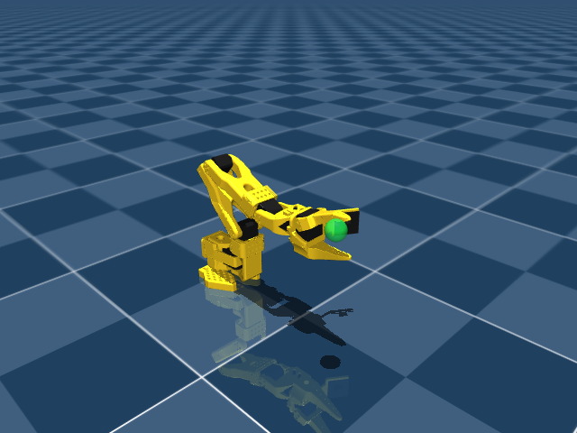

# The robot, physical workspace, and learning task

[Project overview](../README.md) · [Documentation index](README.md)

The default learning task is now stage-one grasp, lift and hold, implemented in [so101_sim/grasp.py](../so101_sim/grasp.py). It controls all six joints and requires physical contact on both jaws with the ball clear of the desk. See [Grasping](grasping.md) for its interface and failure rules. The shared physical workspace and retained three-joint reach task, `SO101ReachableSurfaceBall-v4`, are implemented in [so101_sim/env.py](../so101_sim/env.py).

## Desk and robot placement

| Property | Value |
| --- | --- |
| Desk width × depth × floor-to-top height | 1.2 × 0.7 × 0.75 m |
| Desktop thickness | 0.03 m |
| Desk center in world XY | `[0.4, 0]` m |
| Desktop XY extent | x = −0.2…1.0 m; y = −0.35…0.35 m |
| Robot base position | `[0, 0, 0.75]` m |
| Desk legs | Four fixed, collision-enabled legs |

The size is based on published [IKEA TROTTEN dimensions](https://www.ikea.com.tw/en/products/office-workspace/office-desks-and-tables/trotten-spr-39621918). It is a dimension reference, rather than a detailed furniture replica. The workspace is composed around the robot without changing the pinned upstream asset files.



## Ball and simulation dynamics

| Property | Value |
| --- | --- |
| Ball radius / mass | 0.015 m / 0.02 kg |
| Ball state | A free body: translation and rotation |
| Gravity | `[0, 0, -9.81]` m/s² |
| Physics timestep | 0.001 s, or 1,000 Hz |
| Physics steps per policy action | 50 |
| Policy control interval | 0.05 s, or 20 Hz |
| Solver iterations | Up to 50 |
| Contact dimensions | `condim=6` |
| Sliding / torsional / rolling friction | `[0.6, 0.005, 0.0005]` |
| Contact `solref` | `[0.002, 1]` |

These are nominal, uncalibrated contact parameters, not measurements for a particular material. Aerodynamic drag is not modeled. The [MuJoCo contact reference](https://mujoco.readthedocs.io/en/stable/XMLreference.html#body-geom) explains the parameter meanings.

The ball begins stationary on the desk, with its center at z = 0.765 m. Gravity and contact forces then determine its motion. The simulation does not pin the ball in place, teleport it during stepping, or apply an artificial support force. It can slide, roll, be pushed, and fall from the desk. Distances and observations follow its current physical center.

The ball adds seven `qpos` coordinates and six `qvel` coordinates for its free joint. These are separate from the robot's six joints and six actuators; the ball does not add a robot control input.

## How reachable targets are selected

Default resets place the ball on the tabletop at a position checked to be within the arm's reach. The sampler tests forward kinematics (FK) on separate scratch simulation data:

1. Sample the first three robot joint angles within the existing action limits, using pan −0.35…0.35 rad, lift −0.55…−0.45 rad, and elbow 1.48…1.6 rad.
2. Place a candidate ball on the desktop, offset 6…10 mm radially outward from the candidate end-effector position to clear the fixed jaw.
3. Accept only a candidate within 14 mm of that end-effector and with all checked contacts nonpenetrating to a numerical tolerance of 1 µm.
4. Keep at least 40 mm between the ball and the robot's initial end-effector position, and at least 20 mm between consecutive automatically or manually selected targets.

This is a reachability check, not a robot controller. The actual arm starts at its exact six-joint home pose with zero velocity. The generating FK angles do not enter policy observations, reported information, or actions. The policy still has to discover how to reach the ball.

Accepted positions typically lie near x = 0.24…0.26 m and y = ±0.075 m. Acceptance comes from the FK and contact checks, rather than an arbitrary floating target box. An explicitly seeded reset reproduces its target independently of the previous one.

## Target duration and resets

Each learning target receives **6,000 control steps per environment**, equivalent to **300 simulated seconds (five minutes)**. A single attempt still has a maximum of 1,200 steps (60 simulated seconds). The two counters have different roles:

| Event | Robot and ball reset | Target budget |
| --- | --- | --- |
| Success or failure before the target budget ends | Robot returns home; ball returns to the same spawn | Retains cumulative exposure to that target |
| Cumulative target boundary | Current attempt is truncated | Next automatic reset samples another reachable target |
| Explicit seeded reset | Starts a fresh, reproducible target | Starts again at zero |
| Explicit `new_target=True` | Selects another target | Starts again at zero |
| Manual N key | Resets the robot and selects another target | Overrides the current target |

The target counter continues across PPO rollouts and network updates. It measures actual control steps, rather than wall-clock time. A faster viewer changes how quickly you see those steps, not how much simulated interaction the target receives.

For callers using the environment directly:

```python
env.reset(seed=42)  # A fresh, reproducible tabletop target.
env.reset()  # Retry the same spawn while its cumulative budget remains.
env.reset(options={"new_target": True})  # Explicitly select another target.
```

Manual mode also selects a new target after 300 seconds of actual physics stepping and resets every joint and command to exact home. Pausing does not advance that budget. Its N key overrides the timer and starts a fresh target budget. The ball stays a free physical body: keeping a target means reusing its spawn during retries, rather than freezing it against robot contact. [Training](training.md) explains the separate total training budget, which counts transitions across all environments.

## Retained reach-task actions and observations

Manual keyboard control can move all six robot joints. The retained reach policy controls only the first three; wrist flex, wrist roll, and gripper targets retain their home values.

| Policy joint | Minimum requested angle | Maximum requested angle |
| --- | ---: | ---: |
| Shoulder pan | −0.5 rad | 0.5 rad |
| Shoulder lift | −1.15 rad | −0.45 rad |
| Elbow flex | 0.8 rad | 1.6 rad |

The three action components lie in `[-1, 1]` and map to absolute joint-position targets in these ranges. Requested positions slew at no more than 0.8 rad/s at the physics rate while retaining the actuator dynamics. The six-joint home pose is `[0, -0.8, 1.2, -0.4, 0, 0.5]` rad; resets restore it exactly, clear velocities and match all six actuator commands.

The policy receives 15 `float32` values:

| Observation group | Values | Transformation |
| --- | ---: | --- |
| First three joint positions | 3 | Normalized against the action-angle bounds |
| First three joint velocities | 3 | Multiplied by 0.1 |
| First three actuator commands | 3 | Normalized against the action-angle bounds |
| Current ball center | 3 | Multiplied by 3 |
| Ball center minus end-effector position | 3 | Multiplied by 5 |

These are fixed feature scales. The current input does not include ball velocity, hold progress, or target time remaining, although diagnostic information exposes some of those quantities. The default grasp task uses a different observation including contact, ball velocity and hold/pin progress; these layouts are not interchangeable.

## Retained reach-task success, failure, and reward

Success requires the `gripperframe` site to remain within **15 mm** of the current ball center, with the norm of the first three joint velocities below **0.3 rad/s**, for **10 consecutive control steps**. At 20 Hz this is a 0.5-second stable hold. Reaching the distance threshold briefly is therefore insufficient.

Robot self-contact and robot contact with the desk or floor cause failure when penetration exceeds 4 mm. Ball contacts with the robot, tabletop, or floor are allowed. Contact failure is checked at the 20 Hz control boundaries. Success or failure terminates an attempt; reaching a time boundary without either condition truncates it.

For distance `d` in meters, the raw environment reward is:

```text
-5*d + 2*(exp(-(d/0.04)^2) - 1)
- 0.002*sum(qvel[:3]^2)
+ 10*success - 10*failure
```

The nonterminal reward is nonpositive, so waiting does not accumulate a positive reward. The training wrapper currently multiplies this reward by 0.01 before PPO receives it; Monitor logs and evaluation reports retain raw reward units. The distinction and the related critic diagnostics are explained in [Training](training.md).

## Floor placement is a physics diagnostic

The arm mounted 0.75 m above the floor cannot reach floor targets. They are excluded from normal learning and manual sampling. An explicit option remains available for tests of support, gravity, and falling:

```python
env.reset(seed=42, options={"ball_surface": "floor"})
```

Those placements are outside the desk footprint and legs, with x = 0.18…0.5 m and absolute y = 0.43…0.65 m. They do not define an additional learned task. A floor-reaching task would require a different mounting or task design.

## Task identity and historical models

`SO101ReachEnv.task_config` records the task identifier, geometry, physics, action ranges, reward, success conditions, and target timing. Checkpoint metadata also includes an environment signature and observation version. These distinguish the current physical-ball task from earlier environments.

Historical checkpoints remain local records. A checkpoint with a different task/environment signature is rejected rather than silently adapted. See [Experiments and evaluation](experiments.md) for compatibility checks and fair comparisons, and [Development](development.md) for the tests that cover these behaviors.
