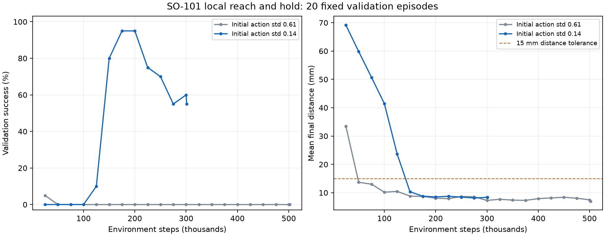
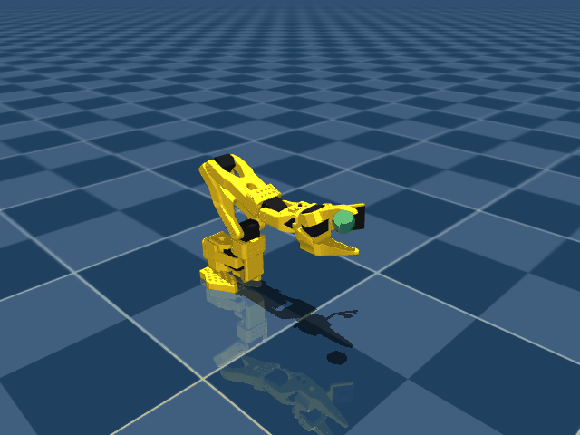

# First SO-101 reach and hold policy

This policy was trained from scratch using PPO and simulated joint state. The task uses three learned joints, with wrist and gripper targets fixed. Success requires distance below 15 mm and combined joint speed below 0.3 rad/s for 10 consecutive 20 Hz steps. Each episode has a 6 second deadline.

## Recorded result

| Policy | Successes / 100 | Mean final distance | Mean episode length |
| --- | ---: | ---: | ---: |
| trained | 80 | 9.29 mm | 1.97 s |
| no_motion | 0 | 75.63 mm | 6.00 s |
| random | 0 | 86.67 mm | 6.00 s |

The learned policy's 95% Wilson success interval is 71.12% to 86.66%. Its 20 failed episodes were timeouts, with no reported collision failures. Mean final distance includes failed episodes. These are local simulation results; they do not establish real robot performance.

## Reproducibility

The selected run used 301,056 environment steps and 378.6 seconds including validation. The included checkpoint was selected at 200,000 steps using 20 validation seeds 10000 through 10019. Two exploration settings were compared by validation success, then distance, then return; held-out performance was not used for selection. Later training regression is visible in the curves, and the best checkpoint is retained.

Held-out evaluation used deterministic actions and 100 seeds 20000 through 20099. No-motion and random baselines used the same reset seeds. Every episode is recorded in [evaluation.json](evaluation.json); the checkpoint metadata records all task parameters, package versions and integrity hashes.

```powershell
python -m so101_sim.train --timesteps 300000 --output runs/reproduce --seed 42 --log-std-init -2
python -m so101_sim.evaluate --checkpoint checkpoints/first_reach/best_model.zip --episodes 100 --seed 20000 --output runs/recheck.json
```



The first animation shows the first successful held-out seed, 20001. The second shows the first held-out seed, 20000, which timed out at a final distance of 15.29 mm. These are actual deterministic policy rollouts. Each final frame is displayed for 900 ms for readability. Preview seeds and metrics are recorded in [preview.json](preview.json).




The package also includes full run configuration, validation history and training curves. Original experimental files remain under the ignored runs directory.
